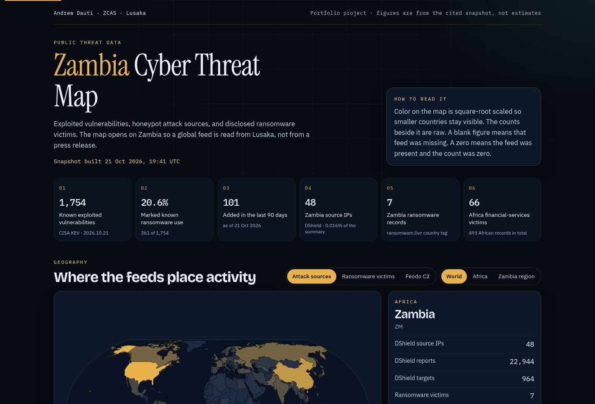
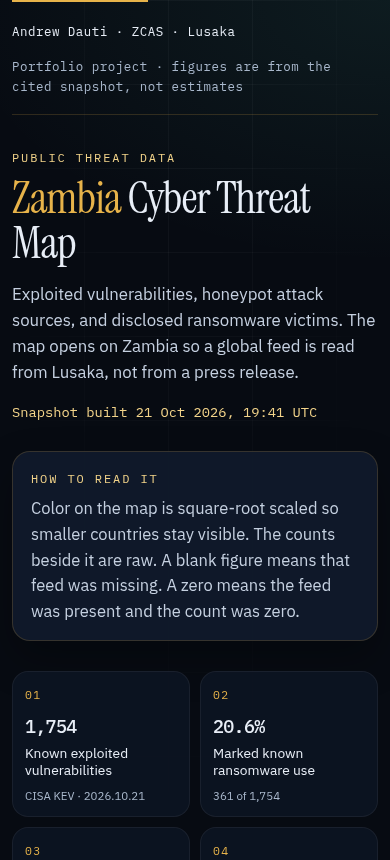

# Zambia Cyber Threat Map

A static dashboard of public cyber threat data, read with Zambia in view. It is a portfolio project by Andrew Dauti, a final-year IT and cybersecurity student at ZCAS in Lusaka.

**Live site:** [andrewdauti.github.io/zambia-cyber-threat-map](https://andrewdauti.github.io/zambia-cyber-threat-map/)

The link works after the site is on the `main` branch and GitHub Pages is switched on. The steps are at the bottom of this file.





## The problem

Global threat reports are easy to find and hard to use. A vulnerability catalog, a honeypot, and a ransomware leak-site dump each answer a different question, and none of them is written from Lusaka. This project puts three public feeds in one place, keeps Zambia selected, and writes the takeaways in sentences that quote the counts.

The numbers are not estimates. A Python script downloads the feeds, checks them, and saves a snapshot. The website reads that file. If a feed is down, the old numbers stay and the page says they are stale.

## What the page shows

- A world map, an Africa map, and a closer view around Zambia. Zambia is outlined on every view.
- Attack sources by country from the SANS Internet Storm Center (DShield).
- Disclosed ransomware victims by country, from ransomware.live, including an Africa chart that keeps Zambia on it.
- The CISA Known Exploited Vulnerabilities catalog: top vendors and products, additions by month, and the share marked for known ransomware use.
- A fixed list of firewall, VPN, and gateway vendors, counted from that catalog.
- The short public Feodo Tracker botnet list, with its own “last updated” line, so a quiet list is not mistaken for a clean network.
- Five short notes under “What this means for Zambian banks.” The sentences are filled from the snapshot, so they change when the data changes.

On the snapshot shipped with this repository, those notes cover the size of the CISA catalog, ransomware flags on edge products, Microsoft Exchange in that catalog, Zambia’s small share of the honeypot data next to a larger African leak-site picture (including financial-services tags), and the fact that the public botnet list is only a handful of addresses.

## Data sources and licenses

The code is [MIT](LICENSE). The data files are not. Details are in [data/DATA_LICENSES.md](data/DATA_LICENSES.md).

| Source | What we use | License | Where it is named on the page |
| --- | --- | --- | --- |
| [CISA Known Exploited Vulnerabilities](https://www.cisa.gov/sites/default/files/feeds/known_exploited_vulnerabilities.json) | Vendor, product, date added, ransomware flag | US government work (public domain) | Footer, and the catalog version in the first figures |
| [SANS ISC / DShield country summary](https://isc.sans.edu/api/country/?json) | Source IPs, reports, and targets by country | [CC BY-NC-SA 4.0](https://creativecommons.org/licenses/by-nc-sa/4.0/). Attribute SANS Internet Storm Center. Do not resell. | Map caption and footer |
| [Feodo Tracker](https://feodotracker.abuse.ch/downloads/ipblocklist.json) | Country and malware family of botnet C2 addresses. IPs are not stored. | [abuse.ch terms](https://feodotracker.abuse.ch/blocklist/) | Feodo card and footer |
| [Ransomware.live victims](https://data.ransomware.live/victims.json) | Counts by country, sector, year, and group. Victim names are not stored. | Non-commercial use with attribution. Say “Source: Ransomware.live”. [Terms](https://www.ransomware.live/t&c). | Charts, bank notes, footer |
| [ThreatFox](https://threatfox.abuse.ch/) and [URLhaus](https://urlhaus.abuse.ch/) | Optional. Recent indicators, only with a free Auth-Key. | abuse.ch. Counts only. | Filled in on the next refresh after the key is added |
| [DB-IP Country Lite](https://db-ip.com/) | Optional. Places those IP indicators on the map. | CC BY 4.0. “IP Geolocation by DB-IP.” The database is not stored. | Only if the Auth-Key path runs |
| [ISO-3166 country list](https://github.com/lukes/ISO-3166-Countries-with-Regional-Codes) | Names and regions | CC BY-SA 4.0 | Country labels |
| [world-atlas](https://github.com/topojson/world-atlas) / [Natural Earth](https://www.naturalearthdata.com/) | Country shapes | ISC, and public-domain geometry | Footer |

## Methodology

The script is `pipeline/fetch_threat_data.py`. It uses only the Python standard library.

1. Each feed is downloaded with a named User-Agent and a size cap. HTML error pages are rejected. A failed feed is retried a few times, then skipped.
2. Counts are computed in `pipeline/transform.py`. Tests for that math are in `pipeline/test_transform.py`.
3. A country missing from a feed that succeeded is a real zero. A feed that failed is left blank, or the previous good copy is kept and marked stale. A failure does not become a zero.
4. Months with no new KEV entries are still written, with a count of zero. The line on the chart only connects those months.
5. “Known ransomware use” is the catalog’s own `knownRansomwareCampaignUse` flag. It is not a guess from the description.
6. The edge-vendor list and the wider banking list are exact `vendorProject` strings. They are written into the snapshot and repeated in “How these numbers were counted” on the page. Microsoft is most of the wider list, so the page treats the edge list as the tighter claim.
7. The Exchange count is Microsoft products named Exchange or Exchange Server. Internet Key Exchange is not counted. The rule is in the snapshot.
8. DShield’s country endpoint does not label its time window. This project does not invent one. A source country is the network a packet came from, not the operator’s nationality.
9. Each ransomware.live record is counted once, as published. Records with no country tag stay in the total and off the map. The page states how many those are.
10. Raw victim records and IP addresses are not committed. The snapshot is aggregates, plus the eight newest KEV rows (those are already public catalog entries).
11. Map color is square-root scaled so smaller countries stay visible. The printed counts are raw. Bar charts are linear.

URLhaus and ThreatFox now require a free [abuse.ch Auth-Key](https://auth.abuse.ch/). Without `ABUSECH_AUTH_KEY`, the script records that those feeds were skipped. It does not scrape the website and it does not fill in malware-family numbers from somewhere else.

## Tech stack

- Python 3.11+ for the pipeline. No third-party packages.
- [Vite](https://vitejs.dev/) for the static site.
- [D3](https://d3js.org/) for the map, the monthly area chart, and the ransomware donut. The bar charts are HTML.
- The hero title is Instrument Serif. Section and card titles are Bricolage Grotesque. Body text is IBM Plex Sans, and figures are IBM Plex Mono. They are self-hosted with `font-display: swap`, so the page does not call a font CDN.
- GitHub Actions refreshes the snapshot and publishes the site with GitHub Pages.

The site is a build of static files. It does not call the feeds from the browser.

## How to run it

From the repository root:

```bash
python3 -m unittest pipeline.test_transform
python3 pipeline/fetch_threat_data.py
cd web
npm install
npm run dev
```

Open http://localhost:5173/zambia-cyber-threat-map/

`npm run build` writes the site to `web/dist`. `npm run preview` serves that folder.

To include URLhaus and ThreatFox on your own machine:

```bash
export ABUSECH_AUTH_KEY="your-key"
python3 pipeline/fetch_threat_data.py
```

The key is read from the environment. It is not printed and it is not written into the snapshot.

## Project structure

```text
pipeline/fetch_threat_data.py    downloads feeds and writes the snapshot
pipeline/transform.py            counting rules
pipeline/test_transform.py       tests for those rules
pipeline/vendor/iso3166.json     country names and regions
data/snapshot.json               the file the website reads
data/countries.csv               country table
data/kev_by_month.csv            catalog additions by month
data/kev_top_vendors.csv         top vendors
data/DATA_LICENSES.md            terms for the data files
web/                             Vite site
.github/workflows/refresh-data.yml
.github/workflows/pages.yml
```

## Refresh the data

`.github/workflows/refresh-data.yml` runs every Monday at 06:17 UTC, and you can run it by hand from the Actions tab. It re-checks the counting tests, downloads the feeds, and commits a new snapshot only if the numbers changed.

If a feed is down, the workflow does not wipe the file. The script keeps the last good section, marks it stale, and the page says so. If every core feed fails and there is no snapshot yet, the script exits with an error and leaves the repository alone.

A commit made by that workflow does not by itself start the Pages workflow. Pages is also triggered when the refresh workflow finishes, so a Monday update is published.

Optional secret, for URLhaus and ThreatFox:

1. Create a free key at https://auth.abuse.ch/
2. In the GitHub repository: Settings → Secrets and variables → Actions → New repository secret
3. Name it `ABUSECH_AUTH_KEY` and paste the key
4. Run “Refresh threat data” from the Actions tab

If the refresh workflow cannot push, open Settings → Actions → General → Workflow permissions and allow read and write.

## Publish the site

The Pages workflow is `.github/workflows/pages.yml`. It builds `web/` and deploys to GitHub Pages. The site expects this address:

https://andrewdauti.github.io/zambia-cyber-threat-map/

That only matches a repository named `zambia-cyber-threat-map`. The path is set in `web/vite.config.js` (`base`).

You have to turn Pages on once. GitHub does not do this from a workflow file:

1. Open the repository on GitHub
2. Settings → Pages
3. Build and deployment → Source: **GitHub Actions**

After the first successful “Publish website” run, the live link above starts working. Until the project is on `main` and Pages is on, the link returns a 404. That is expected.

## Limitations

- DShield source country is not where the attacker lives, and the API does not say how many days the summary covers.
- ransomware.live is leak-site claims. Many records have no country. A claim is not proof, and a missing claim is not proof that nothing happened.
- The Feodo list in current public data is a few addresses and was last updated well before this snapshot. It is a poor picture of malware hosting. URLhaus and ThreatFox would be the better picture, and they need the Auth-Key.
- The CISA catalog is global. An entry does not mean a Zambian bank is exposed. The edge-vendor list is a lens, not an asset inventory.
- Country totals can be inflated by one noisy network or a large cloud provider.
- SANS data is CC BY-NC-SA. ransomware.live does not allow commercial use without permission. A portfolio page is fine. Shipping these files inside a paid product is not, unless you clear those terms.
- This is not Zambia CERT data, and it is not a detection system.

## Author

**Andrew Dauti**
Final-year IT and cybersecurity student, ZCAS, Lusaka, Zambia.

Built as a GitHub portfolio piece for cybersecurity and banking roles: collect a real feed, keep the provenance, and say what the numbers do and do not mean.

## License

The software is [MIT](LICENSE), Copyright 2026 Andrew Dauti.

The snapshot, the CSV extracts, the country list, and the map shapes keep the licenses in [data/DATA_LICENSES.md](data/DATA_LICENSES.md).
